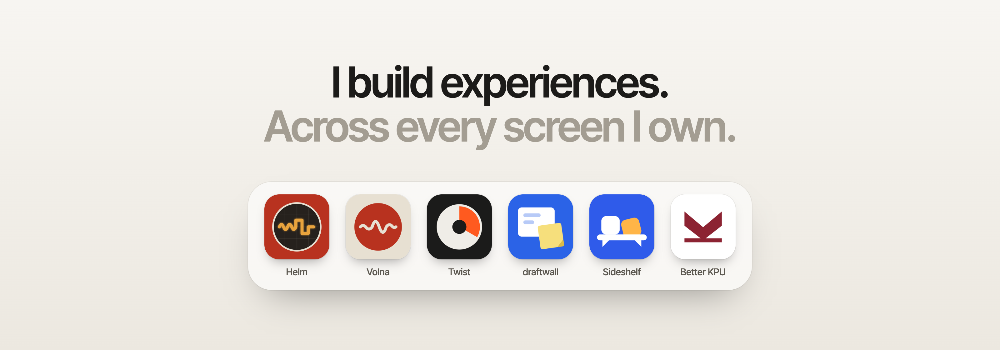
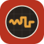

<picture>
  <source media="(prefers-color-scheme: dark)" srcset="assets/hero-dark.png">
  
</picture>

### Hi, I'm Andrew 👋

Sometimes that's a website, sometimes an iPhone app, a backend, a menu bar utility or a tool for AI agents. The platform changes; what I care about stays the same: how the thing feels to use.

I'm curious about technology and like trying new things, but I keep coming back to the small details that make something pleasant to use, and to interfaces that don't look like every other one.

Lately I've been connecting my projects into one system, very much inspired by how Apple's devices work together. My apps on different devices talk to each other, so whatever I start on one is already waiting on the next.

#### Things I've built

- &nbsp;**[Helm](https://github.com/SketchPiece/t3code)** and **[Helm Mobile](https://github.com/SketchPiece/helm-mobile)**: a desktop app for coding agents (my fork of T3 Code) and a native iPhone and iPad app for it. Start agents from the phone, follow their work, open the Mac's screen right there.
- &nbsp;**[Volna](https://github.com/SketchPiece/volna)**: a voice assistant you call like a person. It can check mail or hand a coding task to Helm.
- &nbsp;**[Twist](https://github.com/SketchPiece/Twist)**: a focus timer with a kitchen-timer dial that locks your iPhone, iPad and Mac at once until time runs out.
- &nbsp;**[draftwall](https://github.com/SketchPiece/draft-wall)**: a wall for design mockups. Agents put screens on it, I leave sticky notes, they read them back and iterate.
- &nbsp;**[Sideshelf](https://github.com/SketchPiece/Sideshelf)**: one command puts a fresh build of an iOS app on your iPhone, wherever you are.
- &nbsp;**pieces** (private for now, in progress): my own little cloud for side projects. Every project gets its own address on `pieces.run`, and coding agents deploy them for me.
- &nbsp;**[mail-triage](https://github.com/SketchPiece/mail-triage)** and **[ServerMode](https://github.com/SketchPiece/ServerMode)**: smaller pieces. One sorts an inbox for AI assistants, the other keeps a MacBook running as a server with the lid closed.

#### Before AI

- &nbsp;**[Better KPU](https://github.com/SketchPiece/better-kpu)**: a redesign of my university's service portal that I designed, built and pitched as a student.
- **[TwiChat → Twilight](https://github.com/SketchPiece/twi-chat)**: the chat app I learned web development on. It started in 2019 as Express and EJS, became a React app, and in 2022–2023 grew into an end-to-end encrypted messenger. Every version is on its own branch.
- **[Project Equestria](https://github.com/SketchPiece/project-equestria)**: a Minecraft launcher I built for friends' modded server. It installs Java, checks and downloads the game files and mods, and updates itself.
- **[FlowArc Studio](https://github.com/SketchPiece/flow-arc)**: website for the small studio I co-founded, designed in Figma and built by hand with Astro. [Live site](https://flow-arc.vercel.app).

#### Tools

TypeScript · React · Next.js · Node · Swift · SwiftUI · Rust · Postgres · Figma · and whatever the next project needs
